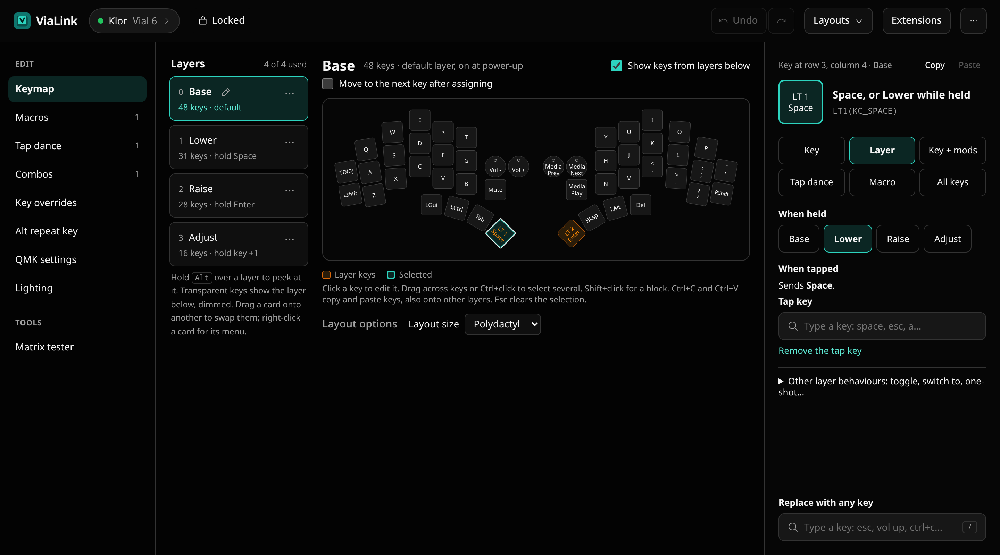
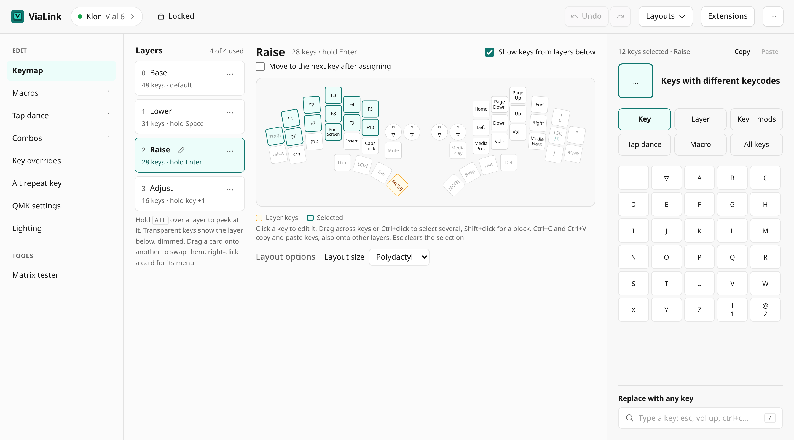
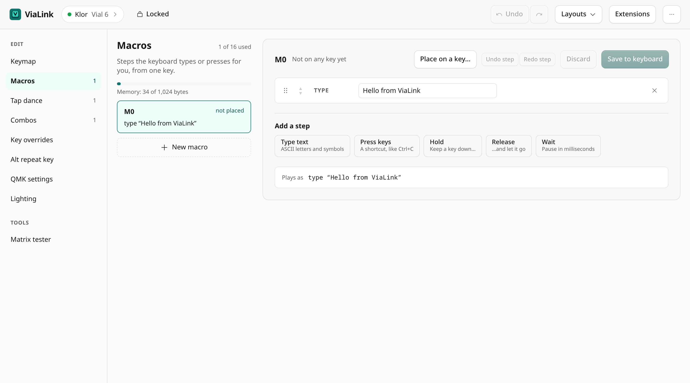
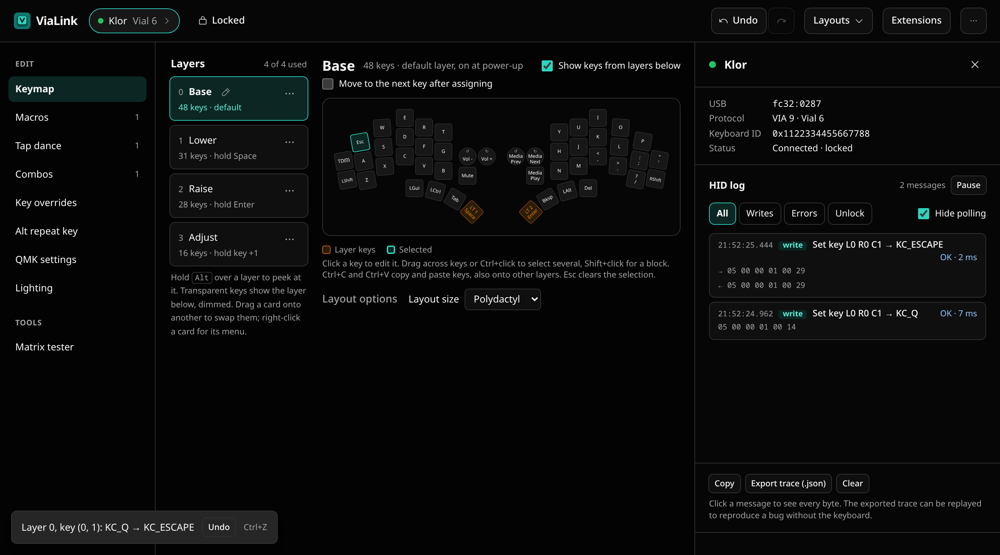

# ViaLink

A browser-based configurator for [Vial](https://get.vial.today/) keyboards. It talks to the
keyboard over WebHID, so it runs in Chromium-based browsers (Chrome, Edge, Opera) with nothing
to install. Try it at https://tsksmiley.github.io/vialink/ (the project was called vial-ts
before). The start page offers both ways to install it: **Install as web app** (Chrome, Edge,
Opera: its own window and icon, also in the ⋯ menu) or **Install standalone app**, the
[desktop app](#desktop-app), which needs no WebHID and so is the way in from Firefox or Safari.



> **Experimental.** ViaLink is vibe coded: most of it was written by an AI coding assistant, and it
> has only been tested on one real keyboard, the [KLOR](https://github.com/GEIGEIGEIST/KLOR) by
> GEIGEIGEIST (plus a simulated keyboard in the test suite). It can write wrong
> settings to your keyboard. Save a backup of your layout (in desktop Vial, or with "Save .vil")
> before changing anything, and report problems as issues.

ViaLink is a TypeScript port of [vial-gui](https://github.com/vial-kb/vial-gui)'s protocol and
keycode logic with a new React UI, and borrows code from [Vialite](https://github.com/tcyeee/vialite).
See [NOTICE.md](NOTICE.md) for what comes from where.

## What it does

- Connects to a Vial keyboard (VIA protocol 9, Vial protocol up to 6), with unlock, lock and a warning
  for vial-qmk example UIDs. A keyboard used before connects in one click, or on its own when it is
  the only one plugged in (browser, web app and desktop app alike), and after an unplug ViaLink
  connects again when it is back. A demo keyboard (a simulated KLOR) lets you try everything without
  hardware.
- **Keymap:** a layer rail (name, keys set, how each layer is reached; Alt to peek) and a key
  inspector beside the keyboard: describe the key in words, build layer keys ("When held / When
  tapped"), add modifiers, pick tap dances and macros, or search any key by name, shortcut (`ctrl+c`)
  or expression (`LT(1, KC_SPC)`). Select several keys by dragging a box, Ctrl+click (⌘ on a Mac) or
  Shift+click for a block, and change them at once.
- **Copy and paste keys:** Ctrl+C copies the selected keys and Ctrl+V puts them on the selected keys
  of any layer, as one undo step: one key fills every selected key, as many as selected pair up in
  reading order, several onto one key keep their shape. The copy also goes to the clipboard as text
  (`KC_A LT1(KC_SPACE)`), and keycode text copied elsewhere pastes the same way.
- **Undo and redo** for every change written to the keyboard (Ctrl+Z / Ctrl+Shift+Z, the top bar,
  and a toast after each change). Loading a layout is one step.
- **Layers:** copy, paste (with a preview and three modes), duplicate, swap (names too) and clear.
  Share a layer as one line of text (`vialink:layer:1:…`) that a friend can paste onto the same kind
  of keyboard, even with other layout options; it fits in a Discord message.
- **Tap dance, combos, macros** as lists with a detail view: combo keys are picked on the
  keyboard, macro steps read as words with step-by-step undo until Save. Key overrides, alt repeat
  keys and QMK settings are editable too.
- **Layer names** on boards running the
  [Theis194 layer-names firmware](https://github.com/Theis194/vial-qmk).
- **Lighting:** backlight, underglow and VialRGB effects, brightness, speed and colour, shown on
  the keyboard while you drag and undoable; Save stores them on the keyboard.
- Save and load `.vil` files compatible with desktop Vial, or keep layouts in the browser.
- A device panel with a readable HID log (filters, export as a replayable trace) and a matrix tester.
- Light and dark theme (follows the system, or pick one in the ⋯ menu); built with Cloudflare's
  [Kumo](https://github.com/cloudflare/kumo) components.

Not yet: the firmware flasher.

### Screenshots

| Several keys selected on a layer                                                                                                                                | A macro, step by step                                                                                                   |
| --------------------------------------------------------------------------------------------------------------------------------------------------------------- | ----------------------------------------------------------------------------------------------------------------------- |
|  |  |

The device panel's HID log decodes every request (here a key change and its undo) and shows its
bytes:



The screenshots show the demo keyboard (a simulated KLOR), which you can try on the website.

## Development

Requires Node 24+ and pnpm.

```sh
pnpm install
pnpm dev            # dev server at http://localhost:5173
pnpm test           # Vitest
pnpm check          # TypeScript
pnpm lint           # ESLint
pnpm format         # Prettier
pnpm build          # production build in dist/
```

On Linux the browser needs read/write access to the keyboard's hidraw device; Vial's
[udev rule](https://get.vial.today/manual/linux-udev.html) covers this.

### Desktop app

For people whose browser has no WebHID (Firefox, Safari), ViaLink also builds as a desktop app
with [Tauri](https://tauri.app): the same web app in the system's webview, with raw HID from the
app's own process (`src-tauri/src/hid.rs`, using hidapi) instead of WebHID. With one keyboard
plugged in it connects on its own at launch; runs of reads (keymap, definition, entries) go to
the keyboard back to back, so a load runs at USB speed. The Linux packages are about 2 MB.

It needs Rust and Tauri's [system packages](https://tauri.app/start/prerequisites/) (on Linux
WebKitGTK 4.1, plus libudev for hidapi). The keyboard needs the same udev rule as in the browser.

```sh
pnpm tauri dev                  # the desktop app with hot reload (Vite on port 1420)
pnpm tauri build                # installers in src-tauri/target/release/bundle/
VIALINK_TRACE=1 pnpm tauri dev  # also log startup and every HID request's timing
```

The "Desktop app" GitHub workflow builds the installers only for a release (a `desktop-v*` tag)
or when started by hand from the Actions tab ("Run workflow"); download them from the run's
Artifacts. Pushes and pull requests don't build them: CI already tests every change.

- **Linux**: `.deb` and `.rpm` (about 2 MB, using the system's WebKitGTK), or an `.AppImage` that
  runs on most distributions. All need Vial's udev rule, as above.
- **macOS**: one `.dmg` for Apple Silicon and Intel. It is ad-hoc signed, not notarized: the first
  time, open it from System Settings > Privacy & Security > "Open Anyway".
- **Windows**: an `.exe` installer or an `.msi`. They are not code-signed: on the SmartScreen
  warning, choose "More info" > "Run anyway".

Pushing a `desktop-v*` tag also attaches them to a draft GitHub release.

### Releasing the desktop app

Installed desktop apps look for a newer version a few seconds after they start (the ⋯ menu turns
that off, or checks by hand) and offer it: **Update**, **Later** or **Skip this version**. Nothing
downloads or installs until the user says so, and the restart is theirs to pick too. Updates come
from the newest published GitHub release, and the app installs only what the release key signed.
An AppImage replaces itself; a `.deb` or `.rpm` install asks for the password to update.

One-time setup of the release key. Keep the key file and its password safe: without them,
installed apps can't be updated.

```sh
pnpm tauri signer generate -w ~/.tauri/vialink-updater.key   # asks for a password
gh secret set TAURI_SIGNING_PRIVATE_KEY < ~/.tauri/vialink-updater.key
gh secret set TAURI_SIGNING_PRIVATE_KEY_PASSWORD             # the same password
gh variable set VIALINK_UPDATER_PUBKEY < ~/.tauri/vialink-updater.key.pub
```

Builds made without the key (local ones, and CI before this setup) have no updater. Each release:

1. Set the new version in `package.json` and merge it to `master`.
2. Tag it: `git tag desktop-v0.2.0 && git push origin desktop-v0.2.0`. The workflow checks that
   the tag names the version, then builds and signs the installers and attaches them, with the
   `latest.json` the apps read, to a draft release.
3. Write the patch notes into the draft (what's new for users, then the fixes) and publish it.
   No release goes out without patch notes. Installed apps offer the update from their next start.

### Layout

- `src/core/`: framework-free protocol code. It never imports React or the DOM and runs under
  Node in tests.
  - `transport/`: the `Transport` interface, the WebHID, native (desktop app) and replay
    transports, and the single-flight `RequestQueue` every command goes through.
  - `protocol/`: command constants and pure encode/decode functions per command.
  - `definition/`: fetching and decompressing `vial.json`, the KLE parser, layout options and
    geometry.
  - `keycodes/`: the per-keyboard `KeycodeTable` and the keycode expression parser.
  - `keyboard.ts`: loads a keyboard and writes changes.
  - `history.ts`: undo and redo of every write.
  - `layers.ts`, `layer-share.ts`, `layerInfo.ts`: layer operations, the share text format and
    facts for the layer rail.
  - `extensions/`: optional features (macros, tap dance, combos, …) probed at connect time,
    and the Extension API they are written against (see "Writing an extension").
  - `vil.ts`: `.vil` save and load.
  - `sim/`: a simulated keyboard that answers commands like the firmware, for tests and the demo.
- `src/app/`: the React UI. `shell/` is the top bar, sidebar, undo and device panel; `keymap/` the
  keymap view; `extensions/` the feature views; `ui/` wraps the Kumo components ViaLink uses;
  `theme.css` holds the colour tokens.
- `docs/`: guides in Markdown, and the website's page for each (`docs/*.html`). The build renders
  the Markdown into the page (`src/docs/markdown.ts`, wired up in `vite.config.ts`); edit the
  `.md` file only. `docs/screenshots/` holds this README's images, taken from the demo keyboard
  at 1440×800, twice the pixels.
- `public/`: the web app manifest and its icons, which make the website installable as an app
  (`src/app/install.ts` offers it in the ⋯ menu), and the favicon.
- `src-tauri/`: the desktop app's shell (Rust): window, app icons and the native HID commands.
- `fixtures/`: keyboard definitions and `.vil` files used by tests.
- `scripts/`: `dump_keycodes.py` and `dump_keymaps.py` regenerate the keycode tables and the
  keyboard layouts (Danish, German, …) in `src/core/keycodes/data/` from a vial-gui checkout.
  `pnpm vial:dump <path>` runs both, to catch up with upstream Vial in one step.
  `compress_fixtures.py` XZ-compresses the fixture definitions.

### Writing an extension

Every feature beyond the keymap is an extension, written against one API: a context (`ctx`)
an extension calls, and hooks ViaLink calls. The design is in the plan doc's "Extension API" tab.
The full guide, with a worked example, is [docs/extensions.md](docs/extensions.md), also on the
website at <https://tsksmiley.github.io/vialink/docs/extensions.html>; this is the short version.

1. **Core part** in `src/core/extensions/<id>.ts`: a `KeyboardExtension` with `id`, `name`,
   `description` and `group`. The group decides what it may send to the keyboard:
   `"standard"` (Vial's standard commands for its own feature), `"compatible"` (no device
   access at all; works on every Vial keyboard) or `"nonstandard"` (standard commands plus the
   custom `commands` it declares, and a `firmware` link). `probe(ctx)` returns its state, or
   null when the keyboard lacks the feature. Add it to `BUILTIN_EXTENSIONS` in
   `extensions/index.ts`.
2. **Manifest**: `requires` / `optional` (other extensions, by id; they probe first),
   `conflicts`, and `provides` (services from `defineService`/`provide`, hook points from
   `defineHook`; ids start with the extension's id).
3. **Through `ctx` only**: `ctx.board` (read-only facts), `ctx.keymap`, `ctx.device` (by group;
   `requestMany` for a run of reads, which the desktop app sends back to back),
   `ctx.history` (record every write for undo), `ctx.state(name, { persist })` (saved state;
   `"layout"` by default, `"browser"` for this browser only), `ctx.schedule` (every, once, idle;
   never your own timers), `ctx.use(service)`, `ctx.notify`, `ctx.ui` (confirm, overlay).
4. **Hooks**: `hooks: [on(layerClear.after, (event, ctx, state) => …)]`. Before handlers may
   `preventDefault(reason)` or `requireConfirm(message)` and can't write; filters adjust the
   plan; after handlers write in the same undo step, and a failure rolls the operation back.
   Handling another extension's hook point needs that extension in `requires` or `optional`.
5. **UI part** in `src/app/extensions/<id>Ui.tsx`, listed in `APP_EXTENSIONS`: views
   (`panels`, each gets `{ ctx, state, ui }`, never the Keyboard), `layerCommands` (menu entries
   and shortcuts), `decorations` (marks on keycaps and layer cards) and `slots`
   (`keyInspector.tab`, `devicePanel.section`, `topBar.item`). Everything draws inside an error
   boundary.
6. **Public API**: anything other code outside the extension folders may use goes in
   `<id>.api.ts`. ESLint stops code outside `src/core/extensions/` and `src/app/extensions/` from
   importing an extension module itself, and stops timers in extension code.

`manifest.test.ts` checks every built-in manifest (known ids, no dependency cycles, prefixed
ids, hook dependencies, groups).

## Licence

ViaLink's own code is GPL-2.0-or-later, as vial-gui. A few files adapted from Vialite are
GPL-2.0-only, so ViaLink as a whole is distributed under GPL version 2. See [LICENSE](LICENSE)
and [NOTICE.md](NOTICE.md) for which files those are.
